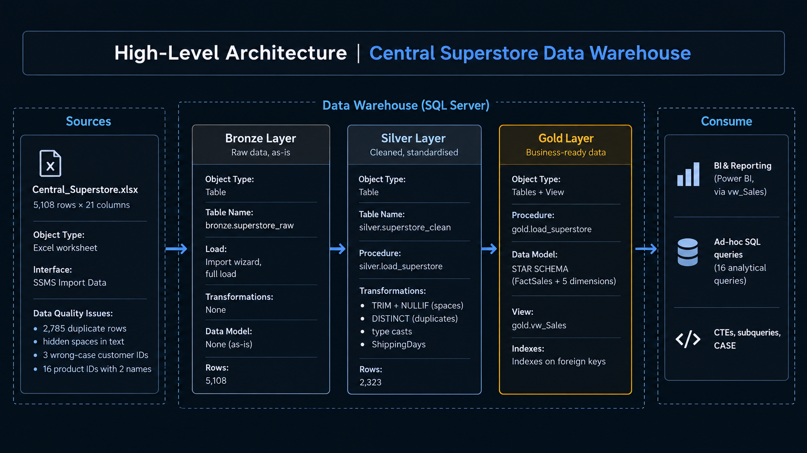
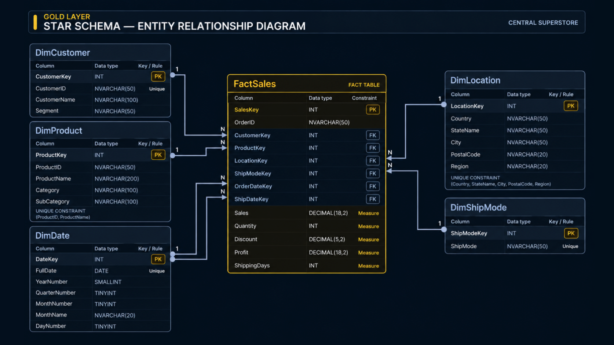

# Central Superstore - Data Warehouse & Business Analytics

**SQL Server (T-SQL) | Medallion Architecture (Bronze → Silver → Gold) | Star Schema | Business Analytics**

## Project Overview

This project transforms the Central region sales data in `Central_Superstore.xlsx` into a SQL Server data warehouse for sales and profitability analysis. The source covers 2013–2016 and contains order, customer, product, location, discount, shipping, sales, and profit information.

The implementation uses three data layers—Bronze, Silver, and Gold. The Gold layer contains a star schema with one fact table and five dimensions. A reporting view combines the dimensional attributes with the measures and classifications used by the analytical queries.

The analysis covers overall KPIs, category and segment performance, annual and monthly trends, customer and product profitability, discount levels, and shipping methods.

## Data Architecture



| Layer | Purpose | Main operations | Object and row count |
|---|---|---|---|
| **Bronze** | Raw source-data layer | Stores the imported Excel data without transformation | `bronze.superstore_raw` — 5,108 rows |
| **Silver** | Cleaned-data layer | Trims text, converts data types, converts empty strings to `NULL`, removes duplicate rows, and calculates shipping days | `silver.superstore_clean` — 2,323 rows |
| **Gold** | Analytical layer | Stores the fact and dimension tables and exposes a reporting view | `gold.*` — 5 dimensions and 1 fact table |

### Star Schema



**Fact table grain:** one row in `gold.FactSales` represents one product line within an order.

| Table | Type | Main columns and constraints |
|---|---|---|
| `gold.FactSales` | Fact | `SalesKey` (PK), `OrderID`, `CustomerKey`, `ProductKey`, `LocationKey`, `ShipModeKey`, `OrderDateKey`, `ShipDateKey` (FKs), `Sales`, `Quantity`, `Discount`, `Profit`, `ShippingDays` |
| `gold.DimCustomer` | Dimension | `CustomerKey` (PK), `CustomerID` (unique), `CustomerName`, `Segment` |
| `gold.DimProduct` | Dimension | `ProductKey` (PK), `ProductID`, `ProductName`, `Category`, `SubCategory`; unique on (`ProductID`, `ProductName`) |
| `gold.DimLocation` | Dimension | `LocationKey` (PK), `Country`, `StateName`, `City`, `PostalCode`, `Region`; unique across these columns |
| `gold.DimShipMode` | Dimension | `ShipModeKey` (PK), `ShipMode` (unique) |
| `gold.DimDate` | Dimension | `DateKey` (PK), `FullDate` (unique), `YearNumber`, `QuarterNumber`, `MonthNumber`, `MonthName`, `DayNumber` |
| `gold.vw_Sales` | View | Joins the fact table to its dimensions and adds `ProfitMarginPct`, `DiscountBand`, and `DurationBand` |

`gold.DimDate` is joined to `gold.FactSales` twice: `OrderDateKey` identifies the order date and `ShipDateKey` identifies the shipping date.

## Data Quality and Transformation

| Source issue | Finding | Treatment in the project |
|---|---|---|
| Duplicate rows | 2,785 of 5,108 raw rows do not remain as separate rows after cleaning | Text is trimmed before `SELECT DISTINCT`, allowing rows that differ only by surrounding spaces to match |
| Extra spaces and empty text | Some text fields contain trailing spaces or empty strings | `TRIM` removes surrounding spaces and `NULLIF(value, '')` turns empty strings into `NULL` |
| Product ID/name conflicts | 16 `ProductID` values occur with more than one product name | `DimProduct` is unique on (`ProductID`, `ProductName`), and the fact load joins on both values |
| Customer ID capitalisation | Three customer IDs have inconsistent letter casing in the source | Source casing is retained |
| Postal code type | Postal codes are imported as numeric values | Conversion through `BIGINT` removes the decimal representation before storing the value as text |
| Row ID repetition | `Row ID` repeats in the raw data | The Silver checks test for repeated `RowID` values after cleaning |

The check scripts include row counts, selected missing-value checks, duplicate checks, customer ID/name consistency, product ID/name conflicts, and a comparison between Silver and `FactSales` row counts.

## Repository Structure

```text
Central-Superstore-DW/
├── README.md
├── data/
│   └── Central_Superstore.xlsx
├── docs/
│   ├── data_architecture.png
│   └── data_model_star_schema.png
├── scripts/
│   ├── ddl/
│   │   └── 00_create_database_and_schemas.sql
│   ├── bronze/
│   │   ├── 01_ddl_bronze_table.sql
│   │   └── 02_bronze_checks.sql
│   ├── silver/
│   │   ├── 01_procedure_load_silver.sql
│   │   └── 02_silver_checks.sql
│   ├── gold/
│   │   ├── 01_ddl_gold_tables.sql
│   │   ├── 02_procedure_load_gold.sql
│   │   ├── 03_gold_checks.sql
│   │   └── 04_view_vw_sales.sql
│   ├── analysis/
│   │   └── 01_analytical_queries.sql
│   └── performance/
│       └── performance optimization.sql
└── results/
    └── expected_results.md
```

The SQL scripts are numbered in execution order. The Bronze table is populated from the `Central_Region$` worksheet in `Central_Superstore.xlsx` using the SQL Server Management Studio (SSMS) import workflow.

### SQL Script Contents

| Script | Purpose |
|---|---|
| `scripts/ddl/00_create_database_and_schemas.sql` | Creates `Central_Superstore` and the Bronze, Silver, and Gold schemas |
| `scripts/bronze/01_ddl_bronze_table.sql` | Creates the raw landing table and documents the Excel import target |
| `scripts/bronze/02_bronze_checks.sql` | Checks raw row counts, selected missing values, and distinct rows |
| `scripts/silver/01_procedure_load_silver.sql` | Defines and executes `silver.load_superstore` |
| `scripts/silver/02_silver_checks.sql` | Validates Silver row counts and selected data-quality conditions |
| `scripts/gold/01_ddl_gold_tables.sql` | Creates five dimensions, `FactSales`, the key constraints, and the `ProductKey` index |
| `scripts/gold/02_procedure_load_gold.sql` | Defines and executes `gold.load_superstore` |
| `scripts/gold/03_gold_checks.sql` | Checks Gold row counts and relationships |
| `scripts/gold/04_view_vw_sales.sql` | Defines `gold.vw_Sales` and includes sample view queries |
| `scripts/analysis/01_analytical_queries.sql` | Contains the 16 business-analysis queries |
| `scripts/performance/performance optimization.sql` | Creates additional indexes on the fact-table foreign keys |

## SQL Features Used (project requirements)

| Requirement | Required | Delivered |
|---|---|---|
| Normalized fact and dimension tables | yes | 1 fact + 5 dimensions |
| Primary and foreign keys, star schema | yes | PK on every table, 6 foreign keys on `FactSales`, unique constraints on the dimensions |
| Relational tables | 5+ | **8** (1 Bronze, 1 Silver, 6 Gold) |
| SQL queries | 15+ | **16** analytical queries (+ data-quality checks) |
| JOIN operations | 3+ | Queries 4-7, 10, 13 and the view (6 joins) |
| CTEs | 2+ | Query 8 and Query 15 |
| Subqueries | – | Query 16 (nested) |
| CASE statements | – | Queries 12, 14 and the view |
| Views | 1+ | `gold.vw_Sales` |
| Stored procedures | 1+ | `silver.load_superstore`, `gold.load_superstore` |
| Performance optimization | yes | Indexes on all foreign keys |

## Analytical Queries

The 16 analytical queries cover the following business questions and SQL techniques.

| # | Business question | Main technique |
|---:|---|---|
| 1 | What are the overall sales, profit, quantity, and profit margin? | `SUM`, calculated ratio |
| 2 | What are the highest and lowest individual sales values? | `MAX`, `MIN` |
| 3 | How many orders were placed, and what is the average order value? | `COUNT(DISTINCT ...)` |
| 4 | What are sales and profit by category? | `JOIN`, `GROUP BY` |
| 5 | What are sales and profit by region? | `JOIN`, `GROUP BY` |
| 6 | What are sales and profit by customer segment? | `JOIN`, `GROUP BY` |
| 7 | How did sales and profit change by year? | `JOIN`, `GROUP BY` |
| 8 | Which 10 customers generated the highest profit? | CTE, `TOP` |
| 9 | Which 5 orders had the highest sales? | `GROUP BY`, `TOP` |
| 10 | Which 5 products had the highest sales? | `JOIN`, `GROUP BY`, `TOP` |
| 11 | Which 10 products had the largest total losses? | `JOIN`, `HAVING`, `TOP` |
| 12 | How many sales lines made a profit, a loss, or broke even? | `CASE`, aggregation |
| 13 | How do shipping days and profitability vary by ship mode? | `JOIN`, `AVG`, `GROUP BY` |
| 14 | How does profit compare across discount levels? | `CASE`, aggregation |
| 15 | What is the monthly sales and profit trend? | CTE, `GROUP BY` |
| 16 | Which products have profit above the average product profit? | View, subquery, `HAVING` |

## Results and Business Findings

The full output of all 16 queries is documented in [`results/expected_results.md`](results/expected_results.md). The following results summarise the cleaned dataset of 2,323 sales lines.

### Overall KPIs

| KPI | Result |
|---|---:|
| Total sales | $501,239.89 |
| Total profit | $39,706.36 |
| Overall profit margin (`SUM(Profit) / SUM(Sales)`) | 7.92% |
| Quantity sold | 8,780 |
| Orders | 1,175 |
| Customers | 629 |

### Sales and Profit by Category

| Category | Sales | Profit |
|---|---:|---:|
| Technology | $170,416 | $33,697 |
| Office Supplies | $167,026 | $8,880 |
| Furniture | $163,797 | -$2,871 |

Technology has the highest total profit among the three categories. Furniture has substantial sales but a negative total profit.

### Sales and Profit by Customer Segment

| Segment | Sales | Profit |
|---|---:|---:|
| Consumer | $252,031 | $8,564 |
| Corporate | $157,996 | $18,704 |
| Home Office | $91,213 | $12,438 |

Consumer accounts for the largest sales total. Corporate and Home Office have higher profit relative to sales than Consumer in this dataset.

### Sales and Profit by Year

| Year | Sales | Profit |
|---:|---:|---:|
| 2013 | $103,838 | $540 |
| 2014 | $102,874 | $11,717 |
| 2015 | $147,429 | $19,899 |
| 2016 | $147,098 | $7,551 |

Sales were nearly unchanged from 2015 to 2016, while profit declined by approximately 62%.

### Profit by Discount Level

| Discount level | Sales lines | Sales | Profit |
|---|---:|---:|---:|
| No Discount | 828 | $243,151 | $76,125 |
| Low (up to 20%) | 852 | $128,955 | $15,973 |
| Medium (over 20% to 50%) | 205 | $105,526 | -$15,909 |
| High (over 50%) | 438 | $23,608 | -$36,484 |

Sales lines with discounts above 20% have a combined loss of approximately $52.4K in this dataset. This is an observed association in the data; it does not establish that discount level alone caused the losses.

### Profit and Loss Lines

Of the 2,323 sales lines, 1,571 have positive profit, 741 have negative profit, and 11 break even. The loss-making lines have a combined loss of approximately $56.3K.

### Shipping Duration by Ship Mode

| Ship mode | Average shipping days |
|---|---:|
| Standard Class | 4.99 |
| Second Class | 3.33 |
| First Class | 2.32 |
| Same Day | 0.03 |

### Customer, Product, and State Findings

- **Top customer by profit:** Tamara Chand, with $8,745.06 profit across two orders.
- **Largest product loss:** GBC DocuBind P400 Electric Binding System, with -$3,048.62 profit.
- **State-level result:** Texas has approximately $170K in sales and -$25.7K in profit, the largest state-level loss in the dataset. Illinois follows with approximately -$12.6K in profit.
- **Query 16:** 358 products have total profit above the average total profit per product in the cleaned dataset.

The state-level figures are obtained by grouping `gold.vw_Sales` by `StateName` and summing `Sales` and `Profit`.

## Design and Scope

- **Duplicate handling:** `TRIM` is applied before `DISTINCT`, so rows that differ only by surrounding text spaces can be treated as duplicates.
- **Product identity:** `ProductID` alone is not used as the unique product identifier because 16 IDs occur with multiple product names in the source. The product dimension and fact-table load use both `ProductID` and `ProductName`.
- **Profit margin:** The overall margin is calculated as `SUM(Profit) / SUM(Sales)`. `ProfitMarginPct` in `gold.vw_Sales` represents the percentage for an individual sales line and is not additive.
- **Date dimension:** `DateKey` is an identity value. `DimDate` contains distinct dates present in order and ship dates rather than a continuous calendar.
- **Scope:** The source covers the Central region and the years 2013–2016. It contains no cost column, so the analysis uses the provided `Sales` and `Profit` values.

---

This project was developed as a mini-project required for the Professional Data Analyst Track under the Digital Egypt Pioneers Initiative (DEPI).

**Author:** Abdulrhman Nasser  
**GitHub:** [AbdulrhmanBI](https://github.com/AbdulrhmanBI)
